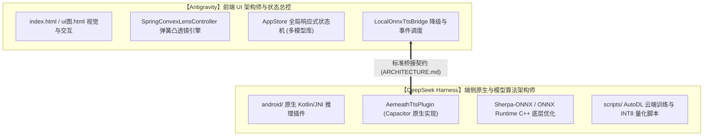

# 《爱弥斯 (Aemeath) 离线语音陪伴终端》双 AI 协同工程宪章 (AGENTS.md)

> **版本**：v2.0.0-PROD  
> **适用代理**：Antigravity (前端架构与 UI 状态总控) & DeepSeek Harness (原生插件与端侧量化专家)  
> **工程目录**：`D:\语音模型项目`  
> **开源协议**：GNU AGPL-3.0

---

## 1. 项目定位与核心技术栈

本项目是一款专为《鸣潮》电子幽灵角色“爱弥斯 (Aemeath)”打造的高拟真、低延迟、完全离线的二次元移动端语音角色扮演陪伴终端。

### 1.1 前端交互与壳应用层
* **技术栈**：自包含零依赖单页 HTML5 + Tailwind CSS (CDN/本地离线化) + 纯原生 ES2022 / TypeScript。
* **原生桥接**：基于 Capacitor 6.x 封装为 Android / iOS 原生应用，深度调用端侧硬件加速与安全存储。
* **物理光学引擎**：iOS 26 纯白极简液态玻璃系统 + 1ms 子步长双耦合阻尼弹簧水晶凸透镜控制器 (`SpringConvexLensController`)，无卡顿、无回弹跳变、无彩虹伪影。

### 1.2 语音推理“双轨三档”架构体系
系统彻底告别单一模型固定架构，在端侧实行分级动态分流与按需量化：

| 档位名称 | 核心神经网络架构 | 底层绑定推理引擎 | 量化策略与尺寸 | 典型推理延迟 | 适用硬件与场景 |
| :--- | :--- | :--- | :--- | :--- | :--- |
| **Lite 轻量极速版** | `Bert-VITS2 / MeloTTS` | `Sherpa-ONNX` (C++ JNI / WASM) | INT8 动态权重量化 · 约 **78.4 MB** | **~18ms** | 中低端手机 CPU/NEON，日常极速流式打字对话 |
| **Pro 高还原旗舰版** | `GPT-SoVITS v2` | `ONNX Runtime Mobile` | T2S INT8 + SoVITS 声码器 FP16 · 约 **142.6 MB** | **~35ms** | 中高端手机 GPU/NNAPI，高还原声线与情绪表现 |
| **Ultra 情绪导演版** | `IndexTTS2` (前处理剥离+8维解耦) | `ONNX Runtime Mobile` | INT8/FP16 混合权重 · 约 **450.0 MB** | **~48ms** | 旗舰 NPU/GPU 混合加速，殿堂级长剧场角色扮演 |

---

## 2. 双 AI 协同开发职责边界 (Role Boundaries)

为确保工程的高稳定性、零代码冲突与模块独立演进，两位智能体必须严格坚守以下物理边界：

* **Antigravity 专职范畴**：
  1. 维护 `index.html`、`ui图.html` 的所有 HTML 骨架、CSS 液态玻璃样式、SVG 滤镜与组件逻辑。
  2. 维护 `src/` 中 TypeScript 领域模型、状态机 `AppStore`、正则动作分流 `StreamRegexParser` 与前端调度 `LocalOnnxTtsBridge`。
  3. 维护项目共享记忆文档（`AGENTS.md`、`ARCHITECTURE.md`、`PROGRESS.md`）。
  4. **严禁**：在没有明确原生需求时擅自修改 `android/` 底层原生 C++/JNI 构建脚本或重写训练代码。

* **DeepSeek Harness 专职范畴**：
  1. 负责 `native/android/` 与 `android/` 目录下的 Kotlin 插件、JNI 动态链接库 (`.so`)、ONNX Runtime Mobile 与 Sherpa-ONNX 原生依赖集成。
  2. 负责 `scripts/` 下的 AutoDL 云端微调训练、数据集预处理、模型蒸馏及 ONNX INT8/FP16 导出与动态量化流水线。
  3. 负责在 Android 原生层落实 `AemeathTtsPlugin`，对接 NPU/NNAPI 硬件加速后端。
  4. **严禁**：越界修改 `index.html` 的前端 DOM、CSS 变量、弹簧阻尼系数或篡改头像逻辑。

---

## 3. 强制开发红线 (Strict Engineering Red Lines)

任何 AI 代理在执行代码变更时，必须 100% 遵守以下铁律，违反红线将被立即判定为代码重构事故并强制回滚：

1. **红线 1：极简视觉与物理引擎完整性**
   * 严禁破坏 `index.html` 的 iOS 26 纯白极简液态玻璃风格（默认纯白色 `#FFFFFF` 背景）。
   * 严禁修改或弱化 1ms 子步长双耦合阻尼弹簧引擎（`SpringConvexLensController`）的光学放大、feDisplacementMap 真实折射与微光辉光效果。
   * 严禁破坏用户自定义软件背景（纯白、纯色色卡、图片壁纸、柔光白纱遮罩）与全新方框及文字柔光玻璃化功能（`0%~100%` 透光度、`0px~24px` 柔光模糊）。
2. **红线 2：标准正圆形 AI 头像硬性规范**
   * 所有 AI 头像必须直接引用根目录真实高清原图：
     - 主头像（槽位 0）：`1794568840819.jpg`（眨眼微笑托腮款）；
     - 预备头像（槽位 1）：`1794568844420.jpg`（比耶抱黑猫玩偶款）。
   * **绝对严禁** 使用任何 SVG / Canvas 代码绘制或矢量化生成头像，必须使用标准 `` 并裁剪为正圆形（`border-radius: 50%`）。
3. **红线 3：模型推理严禁退化为 Argmax**
   * 在 GPT-SoVITS 2 与 IndexTTS2 的自回归解码实现中，**严禁使用任何 `argmax(logits)` 贪婪解码**。
   * 必须强制走完完整的概率核采样管线：Temperature 缩放 + Repetition Penalty 滑动惩罚 + Top-K 截断 + Top-P Nucleus 概率截断 + Multinomial 多项式随机分布抽样，确保语气灵动自然、彻底杜绝复读与死循环。
4. **红线 4：双环境自适应与优雅降级**
   * 前端代码在脱离 Android 原生环境（普通桌面浏览器直接双击打开 `index.html` 或 Vite 预览）时，必须通过 Web Worker 与 Web Audio 仿真流 100% 正常发声与交互，绝不能报错白屏或阻塞用户操作。

---

## 4. 协同交接班流程 (Handover Protocol)

1. **开工检查**：开始任务前，先阅读 `PROGRESS.md`，确认上一轮交接班记录与当前各模块状态。
2. **严格单向通信**：前端与原生之间的功能扩充，必须先在 `ARCHITECTURE.md` 中以 TypeScript 接口定义入参和出参。
3. **完工归档**：每次完成功能编写、重构或测试通过后，必须向 `PROGRESS.md` 追加交接班条目，明确指出所改动文件及遗留待办事项。
