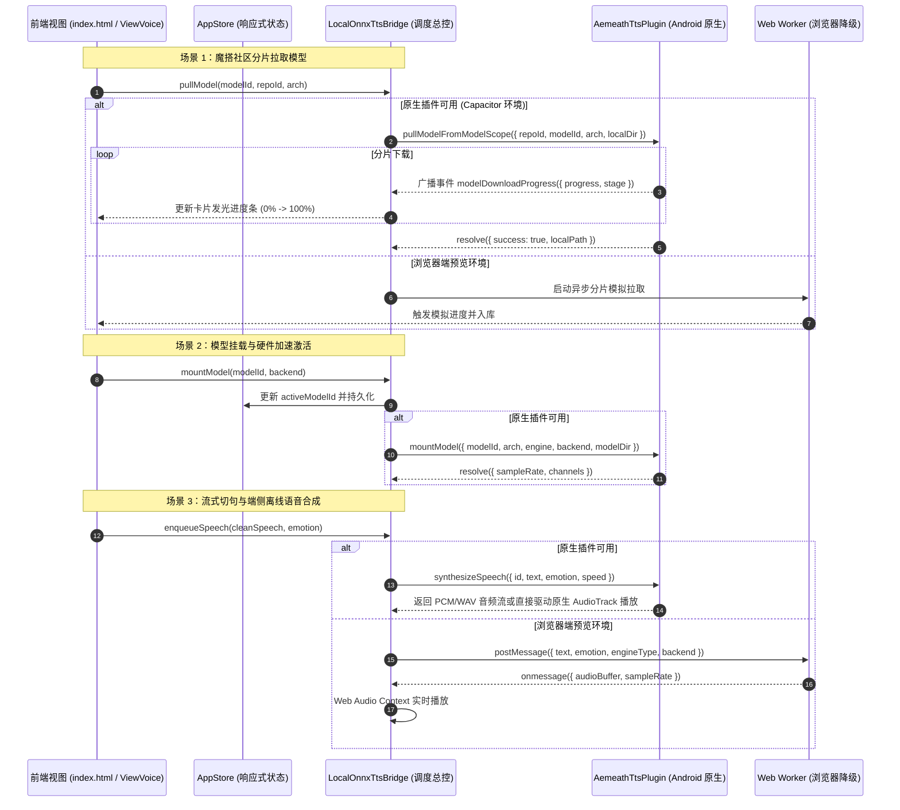

# 前后端与移动端原生桥接契约规范 (ARCHITECTURE.md)

> **修订版本**：v2.0.0  
> **服务双方**：Web 前端 (`LocalOnnxTtsBridge`) $\Longleftrightarrow$ Android 原生插件 (`window.Capacitor.Plugins.AemeathTtsPlugin`)  
> **数据总线**：Capacitor Bridge JSON-RPC + Web Audio / Native AudioTrack 双通路

---

## 1. 总体架构拓扑



---

## 2. Capacitor 原生插件契约 (`AemeathTtsPlugin`)

原生插件必须挂载至 `window.Capacitor.Plugins.AemeathTtsPlugin`，严格遵循以下方法签名与数据结构：

### 2.1 `pullModelFromModelScope`
从魔搭社区 (ModelScope Hub) 下载并校验微调声学模型包，存入移动端沙盒目录。

* **调用入参 (`PullModelOptions`)**：
```typescript
interface PullModelOptions {
  repoId: string;       // 魔搭仓库 ID，如 "aemeath/vits-aemeath-lite-onnx"
  modelId: string;      // 本地模型标识，如 "aemeath-vits-lite"
  arch: string;         // 模型架构："Bert-VITS2" | "GPT-SoVITS v2" | "IndexTTS2"
  localDir: string;     // 沙盒目标目录，如 "models/aemeath-vits-lite"
}
```

* **回调返回 (`PullModelResult`)**：
```typescript
interface PullModelResult {
  success: boolean;
  modelId: string;
  savedDir: string;     // 存储在沙盒中的绝对路径
  totalBytes: number;
  hashVerified: boolean; // SHA256 完整性校验结果
}
```

* **原生持续广播事件 (`modelDownloadProgress`)**：
原生在下载各个分片（主模型 `.onnx`、词典 `tokens.txt`、情绪向量 `emotions/*.bin`）时，需高频触发此事件：
```typescript
interface ModelDownloadProgressEvent {
  modelId: string;
  progress: number;     // 0 ~ 100 整数进度
  stage: string;        // 当前阶段描述，例如 "正在下载主权重 model.int8.onnx..."
  downloadedBytes: number;
  totalBytes: number;
  speed: string;        // 实时下载速率，如 "4.2 MB/s"
}

// 前端监听范例
window.Capacitor.Plugins.AemeathTtsPlugin.addListener(
  'modelDownloadProgress',
  (data: ModelDownloadProgressEvent) => {
    // 驱动 UI 对应卡片的 iOS 26 发光进度条与文本
  }
);
```

---

### 2.2 `mountModel`
将已拉取或本地导入的模型权重、字典文件与 4 组情绪特征向量热装载至端侧内存中，并激活指定硬件推理加速器。

* **调用入参 (`MountModelOptions`)**：
```typescript
interface MountModelOptions {
  modelId: string;                               // 模型唯一标识
  arch: 'Bert-VITS2' | 'GPT-SoVITS v2' | 'IndexTTS2'; // 神经网络架构
  engine: 'Sherpa-ONNX' | 'ONNX Runtime';        // 底层引擎
  backend: 'npu' | 'gpu' | 'cpu';                // 硬件加速后端枚举
  modelDir: string;                              // 模型所在的绝对路径
  emotionFiles?: {                               // 4 组二次元情绪向量 (.bin) 相对路径
    '平静': string;
    '开心': string;
    '温柔': string;
    '调侃': string;
  };
  samplingConfig?: {                             // 针对 GPT-SoVITS 2 / IndexTTS2 的概率采样约束
    temperature: number;                         // 默认 0.85
    topK: number;                                // 默认 25
    topP: number;                                // 默认 0.90
    repetitionPenalty: number;                   // 默认 1.35
    stopToken: number;                           // 默认 1024
  };
}
```

* **回调返回 (`MountModelResult`)**：
```typescript
interface MountModelResult {
  success: boolean;
  modelId: string;
  engine: string;
  sampleRate: number;      // 输出采样率，如 22050、32000、44100
  channels: number;        // 单声道 1
  accelerationActive: string; // 实际启用的硬件加速，如 "NNAPI (NPU)" 或 "OpenCL (GPU)"
  memoryFootprintMb: number;  // 内存驻留大小 (MB)
  notes?: string;          // 原生侧降级/告警说明（如 "Vulkan EP 不可用，已回退 CPU"）
}
```

> **采样参数优先级（v2.1 补充）**：原生出厂默认 `temperature=0.85 / topK=15 /
> topP=0.90 / repetitionPenalty=1.35 / stopToken=1024`。若前端在 `samplingConfig`
> 中显式传入（例如 `topK: 25`），**以传入值为准**；原生不会用硬编码值覆盖前端。
> 无论哪条路径，都严禁退化为 `argmax`（AGENTS.md 红线 3）：`topK <= 1` 或
> `temperature <= 0` 会被原生 `SamplingConfig.sanitized()` 自动纠正到合法区间。

---

### 2.3 `synthesizeSpeech`
执行端侧离线声学生成。

* **调用入参 (`SynthesizeSpeechOptions`)**：
```typescript
interface SynthesizeSpeechOptions {
  id: string;                                    // 任务流水号，用于并发与打断溯源
  text: string;                                  // 纯净台词 (圆括号动作已被彻底剥离)
  emotion: '平静' | '开心' | '温柔' | '调侃' | '愤怒生气';       // 当前语调情绪标签
  speed?: number;                                // 语速系数，默认 1.0 (0.5 ~ 2.0)
  volume?: number;                               // 音量缩放，默认 1.0 (0.0 ~ 1.0)
  playImmediately?: boolean;                     // 是否由原生 AudioTrack 直接播放 (默认 true)
}
```

* **回调返回 (`SynthesizeSpeechResult`)**：
```typescript
interface SynthesizeSpeechResult {
  id: string;
  durationMs: number;                            // 音频时长毫秒
  sampleRate: number;                            // 采样率
  samplesCount: number;                          // 样本数
  audioBase64?: string;                          // 若 playImmediately=false，回传 base64 PCM/WAV
}
```

* **打断与停止方法 (`stopPlayback`)**：
```typescript
interface StopPlaybackResult {
  stopped: boolean;
}
// 调用方法：
window.Capacitor.Plugins.AemeathTtsPlugin.stopPlayback();
```

---

## 3. 前端 `LocalOnnxTtsBridge` 双模调度实现规范

前端总控类 `LocalOnnxTtsBridge` 必须严格遵循以下三层运行机制：

```typescript
export class LocalOnnxTtsBridge {
  private isNativeAvailable(): boolean {
    return Boolean(
      typeof window !== 'undefined' &&
      window.Capacitor?.isNativePlatform?.() &&
      window.Capacitor?.Plugins?.AemeathTtsPlugin
    );
  }

  // 1. 下载：优先调用原生 AemeathTtsPlugin.pullModelFromModelScope，无原生时触发模拟分片进度
  // 2. 挂载：优先调用原生 AemeathTtsPlugin.mountModel，无原生时在 Worker 内部初始化张量
  // 3. 推理：优先调用原生 AemeathTtsPlugin.synthesizeSpeech，无原生时由 Worker 进行 Float32Array PCM 计算并通过 Web Audio API 播放
}
```

---

## 4. 情绪潜空间特征向量 (.bin) 规范

* 文件格式：纯粹的二进制 Float32 数组，小端序 (Little-Endian)。
* 维度大小：严格固定为 **256 维**（即文件体积刚好为 $256 \times 4 = 1024$ 字节）。
* 载入路径：
  - 静态：`models/aemeath-vits/emotions/<情绪>.bin`
  - 动态：用户导入的语音包解压后根目录下的 `emotions/<情绪>.bin`
* 严禁将向量序列化为 JSON 字符串，原生层采用 `ByteBuffer.asFloatBuffer()` 纳秒级直接零拷贝读取。
* **生成方式（v2.1 补充）**：由 `scripts/export_and_quantize_onnx.py emotions` 从 4 条代表性
  参考原声离线固化（CNHubert mean+std 池化 → 固定种子正交投影 256 维 → 跨情绪去相关），
  因此手机端**无需**运行 CNHubert / Wav2Vec2 前处理模型。脚本会强制校验每个文件恰好
  `256 × 4 = 1024` 字节，维度不符直接报错，绝不产出半个文件。

---

## 5. 原生张量绑定与运行时行为契约（v2.2：已对齐真实权重）

本节定义 `android/app/src/main/java/com/aemeath/terminal/` 中
`GptSoVitsOnnxEngine` / `SherpaVitsEngine` / `AemeathOrtBackend` 的实际行为，
供前端与量化脚本双向对齐。

### 5.1 GPT-SoVITS v2 真实张量签名（以 `Aimisi_v2Pro_e8` 为准）

`Aimisi_v2Pro_e8_FullPack.tar` 内四张图经实测核对，签名如下（原生层按此**精确绑定**，
不做模糊猜测；缺名即报错并列出实际可用张量名）：

| 阶段 | 输入 | 输出 |
| :--- | :--- | :--- |
| `t2s_encoder` | `ref_seq` int64[1,N] · `text_seq` int64[1,T] · `ref_bert` f32[N,1024] · `text_bert` f32[T,1024] · `ssl_content` f32[1,768,S] | `x` f32[1,X,512] · `prompts` int64[1,P] |
| `t2s_fsdec` | `x` · `prompts` | `y` int64 · `k` f32 · `v` f32 · `y_emb` · `x_example` |
| `t2s_sdec` | `iy` int64[1,1] · `ik` · `iv` · `iy_emb` f32[1,1,512] · `ix_example` | `logits` f32[·,1025] · `k` · `v` · `y_emb` · `samples` int64（**弃用**） |
| `vits` | `text_seq` int64[1,T] · `pred_semantic` int64[1,1,S] · `ref_audio` f32[1,L] | `audio` f32[1,N] |

**红线 3 的关键结论**：`t2s_sdec.samples` 的计算链实测为
`MatMul → Gather → ScatterElements → Div → Less/Where → Softmax → Div → Softmax → ArgMax → Cast → Unsqueeze`，
即导出时图内已经完成了「temperature + top-k + **argmax**」的贪婪解码。
端侧若直接取 `samples` 就等于 argmax 解码。原生实现因此**只读 `logits`**，
交给 `AemeathSampler` 完成概率核采样后再作为下一步的 `iy` 喂回，
`prompts/iy_emb` 按末位对齐（`y_emb` 多行时取末行）。

> `t2s_fsdec` 是不可学习的「一阶段前缀预测」，其输出 `y` 由官方管线直接使用，
> 不属于自回归采样环节；自回归只发生在 `t2s_sdec` 循环内。

### 5.2 参考条件包（`conditioning/`）

`ref_seq` / `ssl_content` / `ref_bert` / `ref_audio` 只与参考音有关，由
`scripts/prepare_ref_conditioning.py` 在云端算一次后随模型下发，手机端**不跑 CNHubert / BERT**：

```
conditioning/
├── conditioning.json        # 清单：vocab_size / eos_token / sample_rate / bert_source / g2p
├── <情绪>/ref_seq.i64       # 参考音语义码（int64 LE）
├── <情绪>/ssl_content.f32   # CNHubert 特征 [1,768,S]（float32 LE）
├── <情绪>/ref_bert.f32      # 参考文本 BERT [N,1024]（可缺省 → 喂零）
├── <情绪>/ref_audio.f32     # 32kHz 参考波形 [1,L]（声码器必需）
└── g2p/{symbols.json,char2phone.json}   # 离线字表：汉字 → 音素 id
```

* `text_bert` 依赖逐句文本，端侧按约定**喂零**，`conditioning.json.bert_source`
  会标注 `repo` / `zeros`，`mountModel.notes` 也会提示音质折损。
* `prompt_prefix_tokens`（默认 `-1`=自动）：`fsdec.y` 前多少 token 属于参考音 prompt；
  自动策略为「`y.size > ref_seq.size` 时丢弃前 `ref_seq.size` 个」。
* 条件包缺失 `ssl_content` 时**拒绝合成**并给出可操作错误（`--mode logs` 产出的包属此类）。

### 5.3 硬件后端语义

| `backend` | 原生实现 | 失败/不可用时的行为 | `accelerationActive` 示例 |
| :--- | :--- | :--- | :--- |
| `cpu` | `setIntraOpNumThreads(4)` + `setInterOpNumThreads(1)` + XNNPACK | XNNPACK 方法缺失 → 纯 ARM NEON 4 线程 | `"CPU (XNNPACK) · 4 大核"` |
| `gpu` | 反射探测 `addVulkan` / `addOpenCL` | EP 不存在 → CPU/XNNPACK，并在 `notes` 说明 | `"Vulkan GPU · 4 线程"` 或回退值 |
| `npu` | `addNnapi()` | 建会话因算子不支持失败 → 自动剔除 NNAPI 用 CPU 重建 | `"NNAPI (NPU) · 4 线程"` 或回退值 |

> 回传的 `accelerationActive` 取**声码器**实际生效的后端（大矩阵反卷积才是
> GPU/NPU 的真正受益者）；T2S 与声码器后端不一致时在 `notes` 中注明。

### 5.4 推理链与采样

```
文本 → char2phone.json（离线 G2P）→ text_seq
                                        │
conditioning/<情绪>/{ref_seq, ssl_content, ref_bert, ref_audio}
                                        ▼
                t2s_encoder(INT8) → x + prompts
                                        ▼
                t2s_fsdec(INT8) → 前缀 tokens / k / v / y_emb / x_example
                                        ▼
        t2s_sdec(INT8) 自回归循环（仅用 logits，AemeathSampler 采样）
                Temperature 0.85 + RepetitionPenalty 1.35 + Top-K 15 + Top-P 0.90
                                        ▼
                vits(FP16, I/O 保持 Float32) + ref_audio → Float32 PCM
```

* 采样器 `AemeathSampler` 与前端 `SamplingStrategy.ts` 语义一致：
  重复惩罚窗口 64、Top-K 插入选择（不全词表排序）、Top-P 核截断后重新归一化、
  多项式轮盘抽样；分布过尖时仍保留 ≥2 候选，浮点兜底也走核内均匀抽样，
  **不存在任何 `argmax` 分支**。
* 声码器输出统一做峰值归一（≈-1.1dBFS）、5ms 淡入淡出、`speed` 线性变速后交给
  `AudioTrack`；`playImmediately=false` 时回传 16bit WAV 的 Base64。

### 5.5 事件契约（v2.1 补充）

| 事件名 | 载荷 | 触发时机 |
| :--- | :--- | :--- |
| `modelDownloadProgress` | `{ modelId, progress, stage, downloadedBytes, totalBytes, speed }` | 下载/校验过程中，节流 150ms |
| `speechPlaybackStart` | `{ id, emotion }` | 原生 AudioTrack 开始播放时 |

---

## 6. 云端量化产物契约（`scripts/` 产出）

### 6.1 目录与命名

```
onnx/
├── manifest.json                 # 魔搭清单：文件 / 体积 / SHA256 / 精度 / 采样参数
├── model_io.json                 # 张量 I/O 契约（可选，原生已按 §5.1 精确绑定）
├── quant_report.json             # 量化与校验报告
├── t2s_encoder.int8.onnx         # Int8 动态量化（前端语义）
├── t2s_fsdec.int8.onnx           # Int8 动态量化
├── t2s_sdec.int8.onnx            # Int8 动态量化（可选）
├── vits_vocoder.fp16.onnx        # FP16 声码器（I/O 仍 Float32）
├── conditioning/                 # 参考条件包（见 §5.2，端侧必需）
├── tokens.txt / lexicon.txt
└── emotions/
    ├── 平静.bin  开心.bin  温柔.bin  调侃.bin    # 各 1024 字节
```

命名后缀即精度契约：`*.int8.onnx` = 动态权重量化，`*.fp16.onnx` = 半精度。
原生 `findStageFile()` 按此优先级挑选：编码器 `.int8` → `.onnx` → `.fp16`；
声码器 `.fp16` → `.onnx` → `.int8`。

> **真实权重落盘注意**：`Aimisi_v2Pro_e8_FullPack.tar` 内文件带 `Aimisi_v2Pro_e8_` 前缀
> （如 `Aimisi_v2Pro_e8_t2s_encoder.onnx`），请先重命名为上表的规范名再量化/下发；
> 原生按前缀匹配，带前缀也可识别，但规范名更利于魔搭清单与多版本共存。
>
> **Windows 中文路径**：`onnxruntime.quantization` 会在模型旁写 `-inferred.onnx`
> 中间文件，非 ASCII 目录下其 C++ 层会直接抛 `No such file or directory`。
> `export_and_quantize_onnx.py` 已内置「复制到 ASCII 临时目录量化再搬回」的兜底，
> 在 `D:\爱弥斯\...` 这类路径下也能正常出包。

### 6.2 `manifest.json` 必含字段

```json
{
  "arch": "GPT-SoVITS v2",
  "engine": "onnxruntime",
  "sample_rate": 32000,
  "quantization": { "strategy": "int8_dynamic_frontend + fp16_vocoder", "fp16_keep_io_types": true },
  "sampling_params": { "temperature": 0.85, "top_k": 15, "top_p": 0.9, "repetition_penalty": 1.35, "stop_token": 1024, "greedy_fallback": false },
  "emotion_vector_dim": 256,
  "emotions": { "平静": "emotions/平静.bin", "...": "..." },
  "models": { "semantic_encoder": "t2s_encoder.int8.onnx", "vocoder": "vits_vocoder.fp16.onnx" },
  "files": [{ "path": "t2s_encoder.int8.onnx", "bytes": 123, "sha256": "…", "precision": "int8_dynamic" }]
}
```

Android 下载器**优先**用该 `files[]` 的 `sha256` 做逐文件校验；仓库无此文件时
回退到魔搭 Hub 文件树接口。

### 6.3 训练标注契约

`aemeath.list`（GPT-SoVITS v2 / Bert-VITS2 通用）：

```
<cleaned_wav_abs_path>|aemeath|ZH|<台词文本>
```

文本在生成阶段已完成：全半角归一、标点规整、数字中文化、专有名词同音纠错
（爱弥斯 / 漂泊者 / 拉海洛 / 星炬学院 等），且不含 `|` 与换行。

---

## 7. Android 集成与构建（v2.3：已落地并编译通过）

**现状（2026-11-17 实测）**：`android/` 已是 `npx cap add android` 生成的真 Gradle 工程，8 个
Kotlin 插件已合入，`gradlew assembleDebug` **BUILD SUCCESSFUL**，产物 `app-debug.apk`
64,960,376 B（61.95 MB，`com.aemeath.terminal`）。原始载荷副本移至 `android_payload/` 归档。

| 步骤 | 命令 / 文件 |
| :--- | :--- |
| 生成工程 | 已完成（一次性）；重生成需先将 `android/` 移开再 `npx cap add android` |
| 插件源码 | `android/app/src/main/java/com/aemeath/terminal/*.kt`（8 个文件，已合入） |
| 注册插件 | `MainActivity.java` 中 `registerPlugin(AemeathTtsPlugin.class)`，且在 `super.onCreate` 之前 |
| 依赖 | `android/app/build.gradle`：onnxruntime-android 1.18.0 / `libs/sherpa-onnx.aar`(v2.0.1) / okhttp 4.12.0 / coroutines 1.8.0 |
| 构建 | `JAVA_HOME=D:\tools\jdk17\jdk-17.0.21+9`、`ANDROID_HOME=D:\tools\android-sdk`、`GRADLE_USER_HOME=D:\tools\gradle-home`，`gradlew.bat assembleDebug` |
| 同步 | `npx vite build` → `npx cap sync android` → `gradlew assembleDebug` |
| 调试 | `adb logcat -s AemeathTtsPlugin AemeathSoVits AemeathSherpa AemeathOrt AemeathDownloader AemeathAudio` |

**构建期硬约束（踩过才知道）**：

1. 工程路径含中文（`D:\语音模型项目`）时 AGP 8 会直接失败，必须 `android/gradle.properties`
   里 `android.overridePathCheck=true`。
2. Kotlin 块注释**可嵌套**：KDoc 里出现字面 `/*`（例如写 `conditioning/<情绪>/*.f32`）会开启嵌套
   注释并报 `Unclosed comment`，注释里不要出现 `/*` 序列。
3. Capacitor `PluginCall.getDouble/getBoolean` 返回可空类型，必须 `?.`/`?:` 与 `== true`。
4. 字符串模板后紧跟中文（`"$kind缺少"`）会被解析成一个标识符，必须写 `${kind}缺少`。
5. `ArrayList<Int>` 没有 `toLongArray()`，需 `LongArray(size) { list[it].toLong() }`。

**已知约束**：

1. 官方 `onnxruntime-android` 不包含 Vulkan EP，`backend='gpu'` 会安全回退 CPU/XNNPACK
   并在 `notes` 说明；如需真 GPU 加速须自编译 ORT。
2. Sherpa-ONNX Android 构建通常仅支持 `provider="cpu"`，`npu/gpu` 请求会回退，
   `accelerationActive` 反映真实结果。
3. 插件需 `INTERNET` 权限（Capacitor 默认已声明）用于魔搭下载；模型推理全程离线。
4. **Android 端 BERT 前向已实现并真机验证**（`AemeathBertFrontend.kt`：WordPiece + `bert/model.int8.onnx`
   + `char2phone` 分组对齐，输出 `text_bert` 供 `t2s_encoder`）；真机已实测出声。
5. 真机已验证（骁龙 8 Elite / Android 16 / ORT 1.22.0，2026-11-17）：CPU(XNNPACK) 与 NNAPI 均可建会话，
   但 NNAPI 在本模型上推理报 `ANEURALNETWORKS_OP_FAILED`，故 `mountModel` 采用**推理级回退**：
   非 CPU 后端建会话成功后先做一次极短 warmup 合成，失败即重建 CPU 会话并把原因写进 `notes`。
   Release 签名仍未配置。
6. **图片资源不得哈希**：`1794568840819.jpg` / `1794568844420.jpg` / `kanban_aemeath.png` 被
   `index.html` 内联脚本按原始文件名引用，构建产物必须把三张原图放在 `dist/`（= `assets/public/`）
   根目录；`vite.config.ts` 的 `aemeath-raw-images` 插件负责复制 + 改回原名 + 缺图即构建失败。
7. **禁止用合成音冒充 TTS**：`LocalOnnxTtsBridge` 不创建假 TTS Worker（正弦伪造 PCM 已彻底删除）；
   端侧原生引擎不可用时只报错、不得播放 beep。**UI 反馈音不在此列**——`playMascotChime` /
   `prewarmChimeAudio` / `playLoadingAudioFx` 保留（开屏、公告关闭、点击看板娘的反馈音），且需在
   `AudioContext` 处于 `running` 后播放（suspended 时先 `resume()`），静默失败时用 HTML5 `<audio>` 兜底。
8. **XNNPACK 默认关闭**：Android 16 / ORT 1.22.0 实测，开启 XNNPACK 时 `t2s_sdec` 输出的 logits 错误，
   真机 ASR 结果为「切切的切就我去切忌口」这类乱码；关闭后同一句立刻清晰可辨（见 `PROGRESS.md` §14.3）。
   `AemeathOrtBackend.useXnnpack` 默认 `false`，走纯 ARM NEON；上游修复该 EP 前不要改回 `true`。
9. **BERT 必须用第 21 层特征**：GPT-SoVITS 官方口径是 `hidden_states[-3]`（`1-get-text.py:74`），不是
   `last_hidden_state`。端侧优先加载 `bert/model.layer21.int8.onnx`（`conditioning.json` 的
   `bert_model_layer21`），按 `word2ph`（每字音素数）repeat 对齐到 `[T, 1024]`；条件包里的
   `ref_bert.f32` 必须用同一层重算（首版第 20–39 行重复、norm 174.42 属缺陷，正确 norm ≈ 218.29）。
10. **`t2s_sdec` 的 `y_emb` 必须与 `iy` 末位 token 同步**：图内 `y_emb` 由它自己的 argmax token 过
    `ar_audio_embedding` 得到；运行时若用外部采样 token 覆盖了 `iy` 末位，就必须用
    `conditioning/audio_embedding.f32`（1025×512，从 `s232.pth` 导出）同步覆盖 `y_emb` 末行，
    否则 token 与向量错位会直接产出乱码。
11. **禁止对 `vits` 输出做波形变速**：线性插值重采样会同时改基频与共振峰（花栗鼠/粗嗓）。情绪一律
    1.0× 原速 32 kHz 直出，只做 `normalize(0.89)` + 5 ms 淡入淡出。

