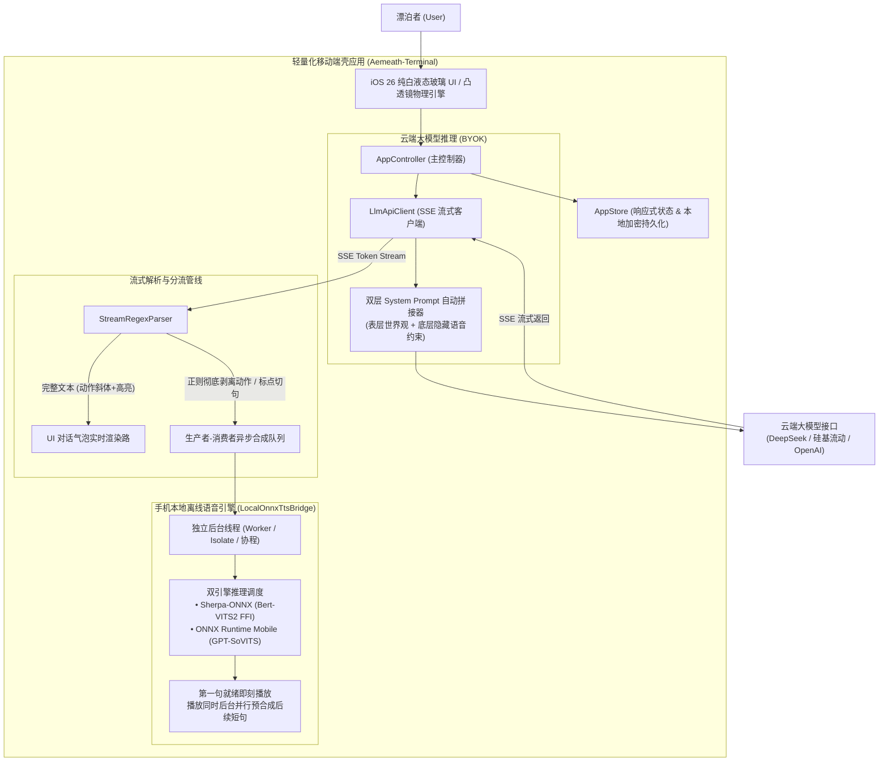

# Aemeath-Terminal（《鸣潮》爱弥斯本地语音角色扮演终端）

[](LICENSE)
[](#)
[](#)
[](#)

> **“在拉海洛星炬学院的晚风中，电子幽灵爱弥斯与漂泊者随时同在。”**

`Aemeath-Terminal` 是一款 100% 开源（基于 **AGPL-3.0** 协议）的移动端二次元 AI 角色扮演与本地离线端侧语音合成终端应用。

---

## 1. 核心架构与设计模式

本项目严格基于 **“轻量化客户端壳应用 + 用户自带云端大模型 API（BYOK） + 手机本地离线加载二次元角色语音模型包（ONNX）”** 架构设计：



---

## 2. 视觉与交互设计规范（iOS 26 纯白极简液态玻璃）

### 2.1 全局背景系统（严格默认纯白 `#FFFFFF`）
- 初始背景**必须且严格默认为纯白色（`#FFFFFF`）**，配合高透纯白微光毛玻璃（`backdrop-filter: blur(22px) saturate(190%)`）达到通透纯净的光学层次。
- 【设置】中支持 3 种背景模式实时切换：
  1. **默认纯白（`#FFFFFF`）**：原生通透液态玻璃质感。
  2. **纯色背景**：预设色卡（纯白、暖玉白 `#FAF8F5`、冰川浅蓝 `#F0F6FF`、星炬浅粉 `#FFF2F7`、薄荷微青 `#EDF7F6`）+ 自由 HTML5 取色器。
  3. **自定义图片壁纸**：支持快捷选用爱弥斯内置原图壁纸 1（`1794568840819.jpg`）、壁纸 2（`1794568844420.jpg`）、手机相册上传或输入网络 URL，支持 **0%~85% 柔光白纱玻璃遮罩**调节。
- **全新沉浸特性：iOS 26 液态玻璃与柔光透光度调节（`Ultra-Glass Mode` 专属独立卡片）**：
  - 设置页设有独立专属调节面板，一键开启后，将聊天气泡、操作卡片、轨道滑槽及文字转变为**极高透光率的柔光液态玻璃**。
  - **双滑杆实时调节**：
    1. **液态玻璃透光度（0%~100%）**：精细控制界面方框对背景壁纸的透出程度，默认 72%；
    2. **柔光散射模糊度（0px~24px）**：自由调节毛玻璃的高斯散射雾化强度，默认 8px。
  - **柔光文字浮雕视效**：正文文字自动施加双层高透白色镜面发光微投影（`text-shadow: 0 1px 2px rgba(255, 255, 255, 0.95), 0 0 12px rgba(255, 255, 255, 0.75)`），使台词文字轻盈悬浮于壁纸画面上方，既清晰易读，又绝不遮挡壁纸核心细节，达到沉浸通透的二次元桌面级视觉享受。

### 2.2 iOS 26 水晶凸透镜滑动组件（`SpringConvexLensController`）
- **多点触控与手势**：所有分段切换器与胶囊开关均支持**手指按住拖拽滑动 + 点击直达切换**。
- **双态光学表现**：
  - *静止态 ($p = 0$)*：磨砂浅灰轨道内的哑光灰胶囊，当前选中项文字高亮为主流光色。
  - *按压/长按/拖动激活态 ($p \to 1$)*：滑块向上膨胀凸出轨道，变为**纯净白水晶凸透镜**（**严禁添加彩虹色散边缘**），内部图文呈现凸透镜球面放大与边缘折射，伴随 `Luminous Bloom` 外层柔光、轨道内部动态追光光斑与文字微光。
- **1ms 子步长双耦合阻尼弹簧引擎**：
  - 无论极速飞拂投射（Velocity Projection）还是**手指长按数秒后再松开**，滑块严格继承手指动量，在滑入目标槽位的过程中沿连续平滑曲线同步完成尺寸回落与水晶态向哑光态的自然过渡，绝无跳变、折返或卡顿。
- **长按滑块凸透镜光学与物理折射实时微调系统（新增）**：
  在设置页【iOS 26 液态玻璃与柔光透光度调节】卡片内，设有专属的凸透镜长按光学与折射物理参数控制台：
  1. **玻璃折射弯曲强度（Refraction Distortion，`0.00`~`0.32`，默认 `0.16`）**：实时调节 SVG `<feDisplacementMap scale="...">` 物理法线位移贴图强度，从 0.00 纯平微透到 0.32 极致水晶曲率折射弯曲；
  2. **长按图文放大倍率（Text Magnification，`1.00x`~`1.65x`，默认 `1.38x`）**：自由控制手指长按滑块时内部文字与图标的透镜放大倍率；
  3. **长按透镜纵向鼓起膨胀（Lens Bulge Height，`1.05x`~`1.55x`，默认 `1.30x`）**：调节长按时水滴纵向膨胀形变物理高度（+5% 轻微隆起 ~ +55% 饱满水珠）；
  4. **晶体月弧高光光泽（Specular Arc Shine，`30%`~`100%`，默认 `95%`）**：调节透镜顶部白水晶月牙弧光的镜面高光反射强度；
  5. **长按试炼体验滑块**：内置实时互动的测试滑块（水滴凸折射 A ⇄ 水晶高光 B），长按或滑动即可零延迟体验各项物理参数变化，并支持一键恢复官方参考物理默认值。

### 2.3 极简三页式架构
- 底部悬浮三段式凸透镜导航栏：**【对话】**、**【语音包】**、**【设置】**。
- **对话界面顶部无框设计**：去掉任何卡片方框或状态栏白条外框，仅在屏幕正上方悬浮一颗无外框的 **【对话 ⇄ 立绘】** 二段式液态水晶凸透镜切换器。

### 2.4 正圆形 AI 头像与原图硬性规范
- 所有 AI 头像框（气泡旁、立绘模式、设置预览、定制模态框）必须采用 **标准正圆形（`border-radius: 50%`）** 裁剪，配合纯白镜面高光环、动态呼吸光圈与面部中心顶部对齐（`object-position: center top`）。
- **严禁使用任何 SVG / Canvas 代码绘制头像**！直接加载真实高清原图：
  - **默认主头像（槽位 0）**：`1794568840819.jpg`（眨眼微笑托腮款）。
  - **预备头像（槽位 1）**：`1794568844420.jpg`（比耶怀抱黑猫玩偶款）。
- 对话中点击任意圆形头像，即可呼出液态玻璃头像管理面板，支持一键在两款原图间切换、从相册选择新原图或输入图片 URL，全局实时响应式联动更新。

### 2.5 凸透镜光学发光主题色与自由拾色系统
- **四段式凸透镜切换器**：预置 3 大官方二次元微光主题色（`冰川蓝 #007AFF`、`星炬粉 #FF2D78`、`极光青 #00C7BE`）与第 4 槽位 **`自定义`**。
- **智能高对比度防吃字算法（W3C 相对感知亮度自适应）**：
  - 当自选主题发光色为**纯白（`#FFFFFF`）或高亮浅色**时，凸透镜外层柔光、手势追光与环境光晕依然呈现出璀璨通透的钻石纯白辉光（`rgba(255, 255, 255, 0.95)`）；
  - 系统自动根据感知亮度算法动态切换为深墨玉色（`#0F172A`），凸透镜放大文字、分段滑块选中文字、用户聊天气泡与发送主按钮均施加纯白双层镜面反光投影，**彻底杜绝“纯白发光导致白字在纯白界面/浅色轨道上隐形”的问题**，保证 100% 清晰易读与通透质感。
- **自由取色器与快捷光特色块**：
  - 预设色卡升级为 **纯白月芒（`#FFFFFF`）**、**琥珀金芒（`#F59E0B`）**、**暮紫星云（`#8B5CF6`）**、**翡翠幽光（`#10B981`）**、**熔金日蚀（`#FF5500`）** 与 **炽热绯红（`#E11D48`）**，支持一键直达；
  - 纯白高透液态玻璃胶囊按钮内嵌原生 HTML5 自由取色器，支持 1677 万色自由选取并在滑动拾色时以 60fps 实时预览，设置状态本地加密持久化。

### 2.6 多调节功能设置项 iOS 26 极简可折叠面板系统（Collapsible Settings）
- **极简无字化交互设计**：
  彻底去除多余的“展开/收起”文字药丸标签，仅保留原生 iOS 26 平滑旋转 `180°` 的折叠指示箭头（`.ios-chevron`），整行标题栏支持任意位置触控触发，极简纯净。
- **120fps 极速纯净折叠与绝对图层隔离（Zero Jank / No Reflow Storm）**：
  1. **内外部盒模型解耦（.ios-collapsible-body + .ios-collapsible-inner）**：外层容器纯净负责高度裁剪（`contain: paint layout`，`margin: 0; padding: 0; border: none`），收起时精准收缩至 `0.000px`，彻底消除边距/内补丁在动画末尾突兀归零导致的跳动抽搐；
  2. **渲染树与合成层彻底剥离（display: none on collapsed）**：折叠收起动画结束后立即自动应用 `display: none !important`，将内部包含的液态玻璃、高斯模糊、SVG 湍流置换和发光图层从 GPU 合成树彻底剔除，杜绝折叠后页面滚动与点击时的多层合成器卡顿；
  3. **局部几何精准同步（Local Slider Metrics Cache）**：彻底剔除全局 `window.dispatchEvent(new Event('resize'))` 广播与 100ms 冗余定时器，仅在特定面板展开完成后局部定向刷新本面板内的滑块几何，杜绝 12+ 个滑块并发 Read-Write 导致的 Layout Thrashing 强迫重排暴风。

### 2.7 iOS 26 方框描边与边缘液态玻璃调节系统（Box Border & Edge Liquid Glass）
- **全局卡片方框（.clean-card）描边色彩自选**：
  - 预设 6 款二次元晶莹描边色卡（纯白晶莹 `#FFFFFF`、冰川浅蓝 `#007AFF`、星炬浅粉 `#FF2D78`、极光微青 `#00C7BE`、暮紫流光 `#8B5CF6`、琥珀金芒 `#F59E0B`）；
  - 配备原生 HTML5 1677 万色自由取色器，滑动即时改变所有方框描边颜色。
- **边缘液态玻璃多维度精细微调**：
  1. **方框描边粗细（Border Width，`0.5px`~`3.5px`，默认 `1.2px`）**：从极细光丝到凝胶粗边无级调节；
  2. **边缘液态玻璃内嵌高光反射（Edge Prism Shine，`10%`~`100%`，默认 `95%`）**：控制卡片边缘凹凸双层镜面反光纯白棱镜反射强度（`inset 0 1.5px 3px ...`）；
  3. **边缘外发光扩散光晕（Edge Liquid Bloom，`0px`~`32px`，默认 `16px`）**：控制卡片边框向外扩散的液态玻璃微光雾化光晕（`0 0 [blur]px rgba(...) `）；
  4. **方框圆角倒角曲率（Corner Curvature，`14px`~`32px`，默认 `24px`）**：自由定制全局方框圆角；
  5. **实时预览与一键恢复**：面板内嵌微型实时预览卡片与一键重置默认按钮，配置持久化于 `localStorage.aemeath_box_glass_v1`。

---

## 3. 完整工程目录结构

```text
D:\语音模型项目\
├── assets/                               # 高清静态资源目录
│   ├── 1794568840819.jpg                 # 爱弥斯默认主头像原图 (眨眼微笑托腮款)
│   ├── 1794568840819.png                 # 主头像 PNG 副本
│   ├── 1794568844420.jpg                 # 爱弥斯预备头像原图 (比耶怀抱黑猫款)
│   └── 1794568844420.png                 # 预备头像 PNG 副本
│
├── models/                               # 本地离线语音模型 DLC 目录
│   └── aemeath-vits/                     # 爱弥斯专属微调语音包
│       ├── manifest.json                 # 语音包元数据配置描述清单
│       ├── model.int8.onnx               # 量化神经网络声学模型权重
│       ├── tokens.txt                    # 音素符号词典
│       ├── lexicon.txt                   # 拼音到音素映射词汇表
│       └── emotions/                     # 情绪特征向量 (.bin) 矩阵
│           ├── 平静.bin                  # 256维 float32 特征向量
│           ├── 开心.bin                  # 256维 float32 特征向量
│           ├── 温柔.bin                  # 256维 float32 特征向量
│           └── 调侃.bin                  # 256维 float32 特征向量
│
├── src/                                  # 核心源码目录
│   ├── main.ts                           # 移动端应用启动入口
│   │
│   ├── core/                             # 核心领域服务层
│   │   ├── store/
│   │   │   └── AppStore.ts               # 全局响应式状态机与 AES 加密持久化存储
│   │   ├── llm/
│   │   │   └── LlmApiClient.ts           # OpenAI 兼容 SSE 流式客户端 (双层 System Prompt 拼接)
│   │   ├── parser/
│   │   │   └── StreamRegexParser.ts      # 流式动作彻底剥离、情绪提取与短句切分管线
│   │   └── tts/
│   │       ├── LocalOnnxTtsBridge.ts     # 本地离线语音桥接器 (生产者-消费者异步播放队列)
│   │       └── tts_worker.ts             # 独立后台 Web Worker (音素转化、向量混合与声学张量生成)
│   │
│   └── ui/                               # 视觉表现与交互层
│       ├── AppController.ts              # 主应用协调器
│       ├── physics/
│       │   ├── ConvexLensMapGenerator.ts # 2D 球面凸透镜桶形法线贴图生成器 (SVG 滤镜注入)
│       │   └── SpringConvexLensController.ts # 1ms 子步长双耦合阻尼弹簧物理控制器
│       └── components/
│           ├── AvatarCustomizationModal.ts # 正圆形原图头像定制模态框
│           ├── BackgroundSystem.ts       # 纯白/纯色/壁纸三模全局背景系统
│           ├── ChatView.ts               # 对话列表与沉浸立绘互动视图
│           ├── VoiceView.ts              # 语音包管理、引擎与加速后端视图
│           └── SettingsView.ts           # API 配置、提示词模板与发光主题视图
│
├── native/                               # 移动端原生跨平台插件桥接
│   ├── android/com/aemeath/terminal/
│   │   └── SecureStoragePlugin.kt        # Android Jetpack Security 加密安全存储插件
│   └── ios/AemeathTerminal/
│       ├── SherpaOnnxPlugin.swift        # iOS Sherpa-ONNX 原生 FFI 插件 (CoreML/Metal)
│       └── KeychainStoragePlugin.swift   # iOS Keychain 硬件级凭据安全存储插件
│
├── android/                              # ✅ Capacitor Android 真工程（2026-11-17 生成并已编译通过）
│   ├── app/src/main/java/com/aemeath/terminal/  # AemeathTtsPlugin 等 8 个 Kotlin（已合入）
│   ├── app/libs/sherpa-onnx.aar          # Sherpa-ONNX v2.0.1 AAR（47.2 MB）
│   ├── local.properties                  # sdk.dir=D:\tools\android-sdk
│   └── README.md                         # 构建命令、5 个编译坑与真机安装说明
│
├── android_payload/                      # 🗄 原始载荷备份（已合入 android/，仅作历史参考，勿改）
│
├── index.html                            # 完整自包含零依赖单页交互终端 (支持直接双击浏览器运行)
├── ui图.html                             # 高保真原型图同步镜像
├── 1794568840819.jpg                     # 根目录主头像资源
├── 1794568844420.jpg                     # 根目录预备头像资源
├── package.json                          # 工程依赖与构建脚本配置
├── capacitor.config.json                 # 移动端打包配置 (Android/iOS)
├── tsconfig.json                         # TypeScript 编译器配置
├── vite.config.ts                        # Vite 开发与打包配置
└── LICENSE                               # AGPL-3.0 开源许可证
```

---

## 4. 核心业务模块与实现细节

### 4.1 模块 A：`AppStore`（全局响应式状态与持久化中心）
- **状态树设计**：集中管理当前视图（`chat` / `voice` / `settings`）、显示模式（`terminal` / `standee`）、发光主题色（`#007AFF` 冰川蓝 / `#FF2D78` 星炬粉 / `#00C7BE` 极光青）、语调、自动播报与括号剥离开关。
- **安全存储**：用户的 `apiKey` 经由安全加密存储（原生层采用 Android `EncryptedSharedPreferences` / iOS `Keychain`；Web 壳层采用 AES-GCM 加密存储），绝不以明文暴露。
- **观察者机制**：基于轻量发布订阅模型，任何状态变更均通知关联视图，零多余重排重绘。

### 4.2 模块 B：`LlmApiClient`（OpenAI 兼容 SSE 流式客户端）
- **BYOK 自由接入**：预设 `DeepSeek`、`硅基流动 (SiliconFlow)`，同时支持任意自定义 OpenAI 兼容网关（如 Ollama、OneAPI、自建 vLLM）。
- **双层 System Prompt 自动拼接机制**：
  $$\text{Full System Prompt} = \text{User Custom Persona} + \text{"\n\n"} + \text{Hidden Voice Constraint}$$
  - **表层（用户自由编辑）**：爱弥斯性格设定、世界观台词风格及对话记忆。
  - **底层（系统代码在发起请求前自动附加的硬性语音约束）**：
    ```text
    【系统底层语音输出硬性约束】
    1. 你必须严格扮演《鸣潮》拉海洛星炬学院的电子幽灵“爱弥斯（Aemeath）”。
    2. 所有神态、肢体动作、心理活动、场景变化描写，必须且只能严格包裹在全角圆括号（）或半角圆括号()内。
    3. 在每一句角色开口说出的台词正文最前方，必须附带一个方括号情绪标签，仅限于：[平静]、[开心]、[温柔]、[调侃] 之一。
    4. 绝不能在没有圆括号包裹的情况下输出任何叙述性或动作性描写文字。
    ```

### 4.3 模块 C：`StreamRegexParser`（流式动作剥离与切句管线）
- 拦截 SSE 数据流返回的实时 Token 序列，执行高精度双路分流：
  1. **UI 气泡渲染路**：
     - 正则匹配 `（...）` 与 `(...)`，动态转换为 `<span class="text-xs text-slate-400 italic">（...）</span>` 浅灰斜体动作描写。
     - 情绪标签 `[开心]` 转换为对应光学发光微芯片。
  2. **本地 TTS 合成路**：
     - 使用正则表达式 `\(.*?\)|（.*?）` **彻底剔除所有括号内的神态动作**，杜绝语音合成模型念出括号内台词。
     - 提取情绪标签，通知语音模型切换情绪声线特征。
     - 使用标点符号切分器（`，。！？～；\n`）将纯净台词切分为呼吸感短句，实时推入后台合成队列。

### 4.4 模块 D：`LocalOnnxTtsBridge` 与多语音模型库管理系统 (`voiceModels`)
- **可扩展多模型库结构 (`voiceModels`)**：
  - 彻底解耦传统单模型布尔状态，支持无限多模型并存、动态增删、热切换与沙盒持久化。
  - 预设 3 大官方二次元声线模型（星炬极速版 v1.0、电子幽灵高还原版 Pro、深夜陪伴轻柔声线 v2.0），支持卡片内一键分片拉取与实时进度展示。
- **纯白液态玻璃两段式子导航切换 (`ConvexLiquidLensSlider`)**：
  - **【模型库管理】面板**：分组展示已安装就绪模型与官方推荐扩展包，支持实时切换激活模型（`activeModelId`）、一键试听与快捷卸载。
  - **【魔搭指令 / 导入】面板**：采用 100% 纯白/浅冰灰高透液态玻璃界面（彻底剔除突兀黑色终端框），支持输入任意作者 ModelScope CLI 指令解析入库，并支持本地 `.zip/.onnx` 离线文件一键建库导入。
- **严格区分模型架构 (Model Architecture) 与底层推理引擎 (Inference Runtime)**：
  - **`BERT-VITS 2 架构`**：底层推理引擎为 **`Sherpa-ONNX · 18ms`**（INT8 动态量化 · 非自回归单文件/双文件 .onnx 管线 · 内置离线中文 G2P 分词与 RoBERTa 文本表征）。
  - **`GPT-SoVITS 2 架构`**：底层推理引擎为 **`ONNX Runtime · 35ms`**（INT8 动态量化 · 自回归 T2S + SoVITS 声学声码器管线 · **严禁退化为简单 argmax，全面支持 Temperature / Top-K / Top-P / Repetition Penalty 多项式核分布概率采样** · 深度集成 4 种情绪 .bin 二进制向量）。
- **生产者-消费者异步流水线**：
  - 推理任务运行在独立 `Web Worker` 或原生后台协程中，与 UI 线程物理隔离，UI 的 120fps 水晶凸透镜滑动动画绝无掉帧。
  - **无感流水线播放**：第 1 句合成完成即刻通过声卡播放，播放期间后台并行预合成第 2 句与第 3 句，消除传统离线 TTS 逐句断续的卡顿等待。未挂载本地模型时智能降级模拟音色并提示用户前往拉取。

---

## 5. 本地运行与打包指南

### 5.1 快速体验（零环境依赖）
无需安装任何复杂框架，在具有现代浏览器的设备上直接打开：
```bash
# 启动内置本地开发服务器
npm run dev
# 或直接在浏览器中打开 index.html
```

### 5.2 移动端构建打包 (Capacitor)

Android 工程已生成并验证可编译（`android/` 内为真 Gradle 工程，APK 61.95 MB）。本机工具链：

| 项 | 路径 |
| :--- | :--- |
| JDK 17 | `D:\tools\jdk17\jdk-17.0.21+9` |
| Android SDK | `D:\tools\android-sdk`（platform-tools / platforms;android-34 / build-tools;34.0.0） |
| Gradle 缓存 | `D:\tools\gradle-home` |

```powershell
# 1. 安装依赖
npm install

# 2. 构建生产静态资源 → dist/
npx vite build

# 3. 同步 Web 资源进 Android 工程
npx cap sync android

# 4. 编译 APK（PowerShell）
cd android
$env:JAVA_HOME="D:\tools\jdk17\jdk-17.0.21+9"
$env:PATH="$env:JAVA_HOME\bin;" + $env:PATH
$env:ANDROID_HOME="D:\tools\android-sdk"
$env:GRADLE_USER_HOME="D:\tools\gradle-home"
.\gradlew.bat assembleDebug --no-daemon --console=plain
# → app\build\outputs\apk\debug\app-debug.apk

# 5. 真机安装
D:\tools\android-sdk\platform-tools\adb.exe install -r app\build\outputs\apk\debug\app-debug.apk
```

> 已在中文路径（`D:\语音模型项目`）下验证通过；`android/gradle.properties` 里的
> `android.overridePathCheck=true` 是必需的。详细排错记录见 `android/README.md` §4。
>
> 懒人版：`powershell -NoProfile -ExecutionPolicy Bypass -File scripts\build_android.ps1 [-Install] [-Clean]`。
>
> 图片注意：三张原图（`1794568840819.jpg` / `1794568844420.jpg` / `kanban_aemeath.png`）由
> `vite.config.ts` 的 `aemeath-raw-images` 插件在构建时复制到产物根目录并保持原始文件名
> （内联 JS 按原名引用，哈希化会导致切换头像/换壁纸破图）。

```bash
# 6. 同步至 iOS 工程 (macOS 环境)
npx cap sync ios
npx cap open ios
```

---

## 6. 开源协议 (License)

本项目遵循 **GNU Affero General Public License v3.0 (AGPL-3.0)** 协议完全开源。欢迎社区共同改进鸣潮二次元角色扮演与端侧离线语音技术！
